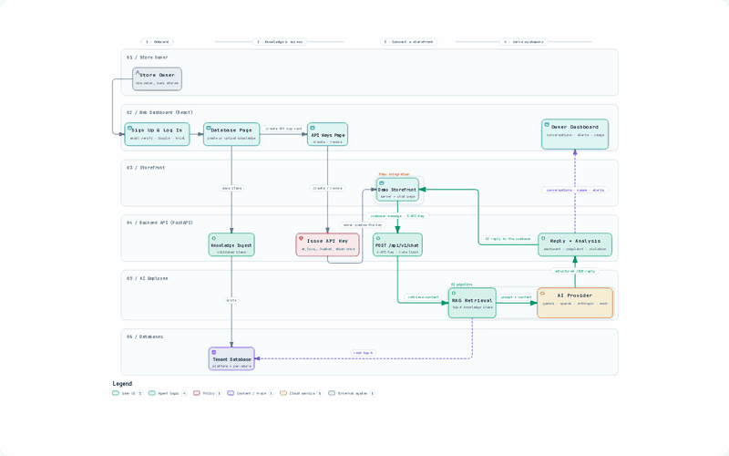

<div align="center">

# AI Employee

**An AI assistant SaaS for e-commerce stores — your store gets a smart employee that answers customers 24/7.**

*Multi-tenant · FastAPI backend · React dashboard · RAG over your own store data · Arabic & English replies*



</div>

---

## What is it?

AI Employee is a platform where an e-commerce store owner signs up, creates a store, uploads the store's
knowledge (products, prices, policies, FAQs) and gets an **API key**. Any storefront then sends customer
chat messages to the public API, and the **AI Employee** replies using *only* the store's own data —
with sentiment analysis, complaint and abuse detection, a human-transfer flow, and a full dashboard
for the owner to monitor every conversation.

The project ships with a **demo store** (`store/`) — a tiny separate webshop that exercises the whole
integration path end-to-end: catalog upload → customer chat → AI reply → history read-back.

## ✨ Features

**For the store owner (dashboard)**
- Full auth flow: signup, email verification, login, forgot/reset password, Google OAuth, one-click trial accounts
- **Database page** — paste or upload store knowledge, one line = one searchable item (auto ids or `ID|text`)
- **Conversations** — live transcript of every customer chat with per-message analysis
- **Complaints / Violations / Alerts** — complaints are triaged into cases; abusive customers are flagged;
  deterministic alerts (e.g. complaint-ratio spike over the last 24 h)
- **Customers** — per-customer history and aggregates
- **Persona** — choose how the AI employee talks (personas seeded per language/tone)
- **API Keys** — create/revoke `ak_live_…` keys for storefront integrations
- **Plans & Usage** — plan limits, token usage, subscriptions (Stripe-ready, optional)
- **System Status** — honest, live health of every platform service (no synthetic data)
- **Overview** — stat cards, 14-day upload series, items-by-source donut, recent activity
- **API Docs** — interactive reference served at `/docs`

**For the AI employee (backend)**
- RAG: every chat retrieves the top-K relevant knowledge items and answers **only** from them —
  never invents products, prices or policies
- Structured reply per message: text + sentiment + complaint/violation flags + matched product id +
  human-transfer request — strict JSON, validated, with safe mock fallback
- Providers: `mock` (no key needed) / Gemini / OpenAI / Anthropic — auto-selected by present keys,
  with bounded retries, backoff, 429-aware pacing and per-call timeouts
- Per-tenant SQLite databases (`platform.db` + one file per store), JWT auth, rate limiting per key,
  CORS allow-list, secrets never echoed

**For the machine (Launcher.py)**
- One-file, zero-dependency terminal launcher: creates venvs, detects missing/outdated packages,
  installs from PyPI or an offline wheel folder, private Node.js download when missing,
  installs & builds the frontend, runs migrations, launches and supervises every service
  (auto-restart, prefixed live logs, graceful Ctrl+C), with `doctor / status / stop / logs / clean / init`
  helper commands

## 🚀 Quick start

Requirements: **Python 3.10+** and git. Node.js is not required — the Launcher fetches a private copy if missing.

```bash
python Launcher.py
```

The launcher walks through four steps — **Libraries → Selection → Prepare → Launch** — asking only what
it needs (main port, worker count, AI provider). When everything is up it prints the URLs:

| URL | What |
|---|---|
| `http://127.0.0.1:5173/` | The dashboard (dev profile; in prod the API serves the built SPA) |
| `http://127.0.0.1:8000/docs` | Interactive API documentation |

First run: **Sign up → Dashboard → Database → upload your catalog → API Keys → create a key**.

Other launcher commands:

```bash
python Launcher.py doctor    # diagnose this machine and this project
python Launcher.py setup     # install + prepare without launching (CI / Docker builds)
python Launcher.py status    # what is running right now
python Launcher.py stop      # stop the running instance
python Launcher.py clean     # remove generated artifacts (venvs, logs, node, build)
```

## 🏪 Demo store — try the whole integration in 3 steps

A tiny store **completely separated** from the main project. Its single job: prove that an external
storefront can talk to the AI Employee through the public API (`X-API-Key`), exactly like a real
integration — the key never reaches the browser; the store server holds it and proxies every call.

**1)** Start the main project in one terminal:

```bash
python Launcher.py
```

**2)** Create a key: open the dashboard → **API Keys** → *New key* → copy it (shown once).

**3)** In a **second terminal** (from the project root) start the store:

```bash
.venv/runtime/venv/backend/bin/python store/server.py      # Windows: .venv\runtime\venv\backend\Scripts\python.exe store\server.py
```

Then open **http://127.0.0.1:9000**.

> **Port note:** if you chose a port other than 8000 in the launcher, the store reads it automatically
> from `API_PORT` in `.env`. Or pass it explicitly: `DEMO_STORE_API_URL=http://127.0.0.1:<port>`.
> Optional: pass the key up front — `DEMO_STORE_API_KEY=ak_live_xxx` — and skip pasting it in the page.

**Inside the page, in order**

1. **Connection** — paste the key → *Save key* → the status badge turns green *"Connected — the integration works ✔"* (auto-checked every 8 s)
2. **Upload the catalog** — pushes all of `store/catalog.txt` (30 items: products + policies + FAQs) via `POST /api/v1/data` and shows the raw response
3. **Store data** — live view of every catalog item (id + text + count), exactly what will be uploaded
4. **Chat** — type as a customer; good probes:
   - *"How much is the cotton T-shirt?"* (product question → answer from the catalog)
   - *"Do you deliver to Alexandria?"* (policy question)
   - *"The order arrived late and I'm upset!"* (complaint → sentiment analysis)
   - *"I want to talk to a human"* (transfer offer → accept button)
   - While waiting: a *"Preparing the reply"* bubble with a live seconds counter; the chat auto-scrolls;
     under every reply: actual response time, sentiment/complaint/violation tags, conversation number,
     server latency and a **raw** toggle showing the full JSON
5. **Read the conversation** — enter the conversation number and see every message from
   `GET /api/v1/conversations/{id}/history`

**`store/catalog.txt` format** — one line = one item uploaded to the AI Employee:

- plain line → auto id (`line-1`, `line-2`, …)
- `SKU-001|Product: …` → your own id (shown in the upload log and the dashboard Database page)
- a line starting with `#` is a comment (ignored)
- edit the file (e.g. put your real products in) and press *Upload* again — **no restart**, the file is read live

**Troubleshooting**

| Badge / message | Cause | Fix |
|---|---|---|
| "Main project is not running" | Launcher not running | start the main project first |
| "no API key is set" | key not pasted yet | Dashboard → API Keys → copy & paste |
| "the key was rejected (401)" | wrong/revoked key | create a new key and paste it |
| upload failed with 429 | rate limit exceeded (60/min) | wait a minute and retry |

## 🤖 AI providers

| Provider | Key | Notes |
|---|---|---|
| `mock` *(default)* | none | deterministic canned replies — full pipeline, zero cost |
| `gemini` | `GEMINI_API_KEY` | preferred real provider when a key is present |
| `openai` | `OPENAI_API_KEY` | gpt-4o-mini |
| `anthropic` | `ANTHROPIC_API_KEY` | claude-3-5-haiku |

Set the key in `.env` (the launcher asks for it hidden and saves it with 600 permissions), or choose the
provider in the launcher's selection step. A real provider that fails (or has no key) falls back to mock
so the customer always gets a safe answer; raw model output is never shipped to a customer.

## 📡 Public API (storefront contract)

| Endpoint | Auth | Purpose |
|---|---|---|
| `GET /api/health` | — | health probe |
| `POST /api/v1/data` | `X-API-Key` | upload knowledge items (the catalog) |
| `POST /api/v1/chat` | `X-API-Key` | customer message → AI Employee reply |
| `GET /api/v1/conversations/{id}/history` | `X-API-Key` | read a full conversation |

The dashboard's **API Docs** page documents the full surface (auth, stores, customers, complaints,
violations, alerts, persona, plans, subscriptions, system status).

## 🗂 Project structure

```
├── Launcher.py            # one-file terminal launcher (venvs, deps, build, supervise)
├── backend/               # FastAPI app: api/routes · services (AI, RAG, auth…) · schemas · core
│   └── services/ai/       # provider adapter (mock/gemini/openai/anthropic) + prompts
├── database/              # schema, connection, per-entity queries, seeds, init_db.py
├── frontend/              # React + TypeScript + Vite dashboard (src/pages, src/services)
├── store/                 # demo store: server.py (FastAPI + one HTML page), catalog.txt
└── .gitignore
```

Runtime files (venvs, logs, the private Node copy, selection state) live under `.venv/runtime/`
and are git-ignored; database files live under `database/data/`.

## ⚙️ Configuration (`.env`)

Core variables (the full schema is created by `python Launcher.py init`):

| Variable | Purpose |
|---|---|
| `SECRET_KEY` | signing key for sessions/tokens (auto-generated) |
| `DATABASE_URL` | platform DB (tenant DBs auto-discovered in `database/data/`) |
| `API_PORT` | written by the Launcher from your port selection |
| `AI_PROVIDER` | `mock` \| `gemini` \| `openai` \| `anthropic` (default `auto`) |
| `GEMINI_API_KEY` / `OPENAI_API_KEY` / `ANTHROPIC_API_KEY` | provider keys (optional) |
| `SMTP_*` | email verification/reset (optional — mock mode logs the link) |
| `GOOGLE_OAUTH_CLIENT_ID/SECRET` | Google sign-in (optional) |
| `STRIPE_SECRET_KEY` / `STRIPE_WEBHOOK_SECRET` | paid plans (optional) |
| `RATE_LIMIT_PER_MINUTE` | API limit per key (default 60) |
| `CORS_ORIGINS` | allowed origins (default: local dev frontend) |

---

<div align="center">
<sub>Built with FastAPI · React · SQLite — launched with one command.</sub>
</div>
